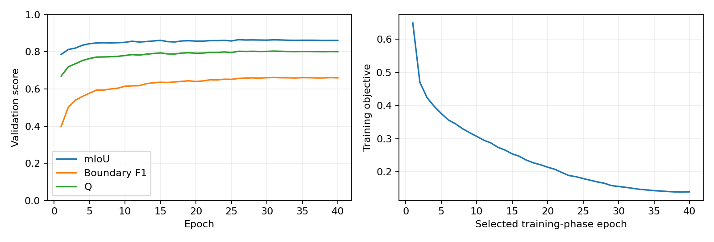
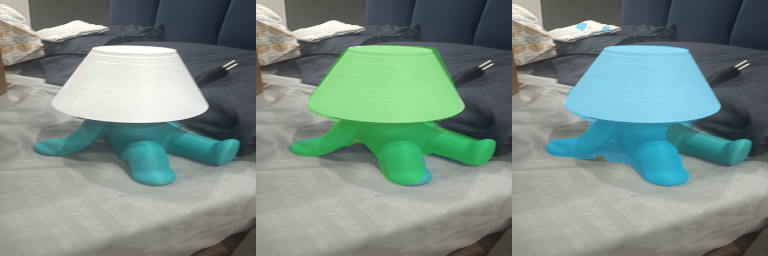
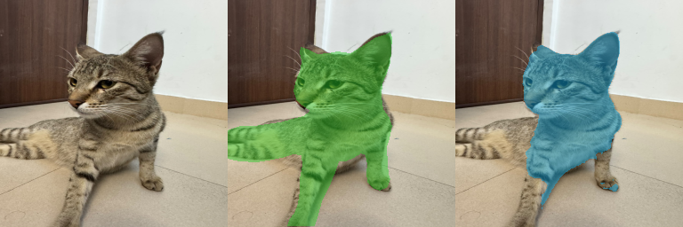
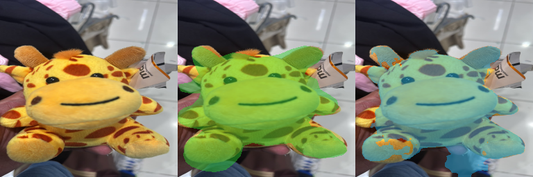
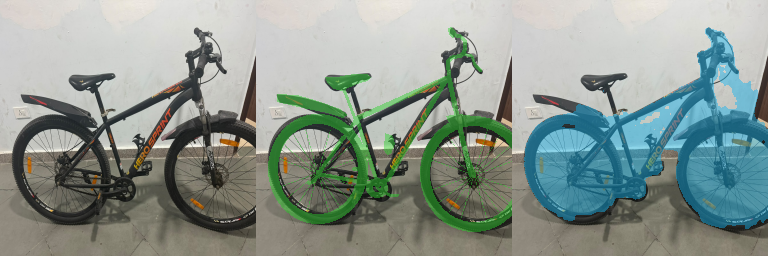
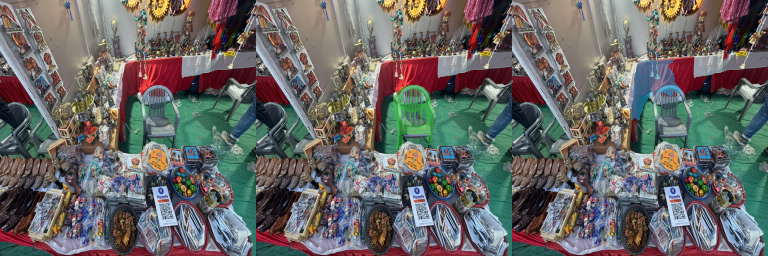
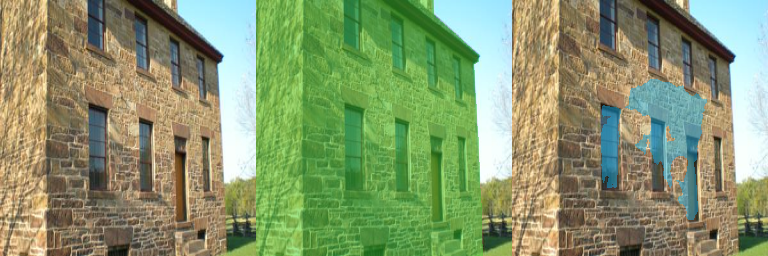
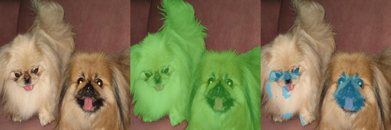

# Cost-Efficient Segmentation under a Compute Budget

Track B: compact fully convolutional segmentation trained from scratch.

## Final results

| Set | Images | mIoU | BF1 | Q | CPU ms/image | Parameter bytes | CES |
|---|---:|---:|---:|---:|---:|---:|---:|
| Validation | 1056 | 0.8641 | 0.6614 | 0.8033 | 12.533 | 499,643 | 0.7535 |
| DUTS-TE | 5019 | 0.7083 | 0.4726 | 0.6376 | 10.821 | 499,643 | 0.6024 |
| Own college photos | 6 | 0.7639 | 0.4507 | 0.6699 | 7.812 | 499,643 | 0.6410 |

The full DUTS-TE mean CPU time is **10.821 ms**, below 50 ms. Compared with the recorded baseline, DUTS-TE CES changes from **0.591971 to 0.602400** (+0.010430, +1.76% relative). Baseline and final timings were measured in separate runs and may vary with the laptop's power/thermal state. The personal-photo row is a test-only generalisation result, not the common CES benchmark.

## Method and training

The selected width multiplier is 1.0; encoder channels are 16, 32, 64, 96, 128. Each stage combines a standard 3x3 convolution with batch normalization/ReLU and depthwise 3x3 plus pointwise 1x1 refinement. Decoder channels are 64, 48, 32, 16, with concatenated encoder skip features. A projected global-average-pooled context vector is added at the bottleneck. A two-logit head and bilinear upsampling restore 256x256 predictions. There are 466,274 trained parameters.

The assignment input photo is resized to 256x256 with OpenCV INTER_AREA. Masks use INTER_NEAREST and threshold >=128. The network internally downsizes its tensor to 160x160; this is included in timing. The final decision is object logit minus background logit > 0.0. Horizontal-flip averaging is disabled.

DUTS-TR has 10,553 pairs. A fixed filename-based seed-42 split gives **9,497 training and 1,056 validation images**, with no overlap. DUTS-TE has **5,019** pairs. The split/fingerprint is in `data/split.json`. No DUTS-TE or captured image was used for gradient training, threshold selection, resolution selection, checkpoint selection or early stopping.

The selected model's recorded training phase ran for 40 epochs; phase epoch 31 had its best validation Q. The original teacher was trained from scratch for 40 epochs and selected at epoch 31; pruning/fine-tuning phases inherit that training lineage, rather than representing the entire training history on their own. AdamW used initial learning rate 0.002, weight decay 0.0001 and cosine decay, batch size 32, random horizontal flips and brightness/contrast augmentation. Loss was pixelwise cross entropy plus foreground Soft Dice. CUDA mixed precision was training-only. A lossless uint8 training/validation cache accelerated loading; it does not enter the timed predictor. GPU training seeds were fixed, but exact numerical reproduction may vary across software/hardware builds.

A half-width candidate with 118,578 parameters was additionally trained from random initialization for up to 40 epochs. Alongside true-mask CE + Dice, it used 0.5 times a soft-target cross entropy from the original full-width teacher, itself trained from scratch solely on this project's DUTS-TR training split. No external pretrained weights or additional data were used. Teacher gradients were disabled. Validation Q selected its checkpoint; personal photos and DUTS-TE never contributed gradients or candidate selection. A third candidate used structured channel pruning to three-quarter width (263,786 parameters), initialized solely from this project's own teacher weights, followed by up to 10 fine-tuning epochs at learning rate 0.0005 with the same training/validation roles and teacher loss. Hidden/output channels were ranked by convolution magnitude times batch-normalization scale, with indices propagated through depthwise layers, skips and context/head connections. No external pretrained weights were involved. Original model selection was followed by validation-only inference/storage selection. The baseline DUTS-TE results had already been reported before this pass; therefore this is a repeated final benchmark, not a claim that DUTS-TE has never previously been inspected. The new grid was fixed in advance and the search scripts read validation data only. The final model was frozen before its new DUTS-TE run.

## Improving CES using validation only

The recorded grid tried internal sizes 128, 160, 192, 224 and 256; flip averaging on/off; and logit biases -0.75, -0.5, -0.25, 0, 0.25, 0.5 and 0.75. Every quality measurement used all 1,056 validation images. Initial grid CPU estimates used 64 repetitions after warm-up on a validation photo. Selection used estimated validation CES, never DUTS-TE or captured scores. The initial full-width grid retained size 160, flip=False, bias=0.0. The later compact-model comparison also tested flip averaging on its packed half-width candidate.

Allowed TorchScript tracing, freezing and `optimize_for_inference` fold/reorder inference operations and remove Python/module overhead. Compilation and parameter loading happen before timing; every per-photo operation remains timed. Convolution kernels are then stored as signed 8-bit values with one float32 scale per output channel, without gzip/ZIP compression of their tensor payloads. Biases and floating-point normalization state retain float16 storage. Same-dtype tensors are concatenated into raw arrays to reduce per-tensor archive headers; no tensor payload is compressed. Values are reconstructed to a float32 PyTorch model before timing. **This is storage quantization, not a separate inference engine.** All quantized values, scales and validated inference settings are contained in the single saved parameter file.

Three storage alternatives were compared using full one-photo-at-a-time validation CPU passes:

| Storage / implementation | Validation Q | Full-validation CPU ms | Bytes | Validation CES |
|---|---:|---:|---:|---:|
| Baseline eager FP16 storage | 0.803500 | 11.941 | 985,783 | 0.746238 |
| TorchScript / float16 | 0.803500 | 9.588 | 985,459 | 0.753805 |
| TorchScript / int8_convs | 0.803310 | 9.618 | 538,004 | 0.762102 |
| TorchScript / int8_except_head_context | 0.803311 | 9.751 | 556,340 | 0.761324 |

These measurements selected the full-width storage candidate. The final architecture/storage selection then compared it with half-width and three-quarter-width variants using a **paired full-validation pass**: all candidates saw every validation photo, with candidate timing order rotated for each image to reduce background-load/order bias.

| Candidate | Validation Q | Paired CPU ms | Bytes | Validation CES |
|---|---:|---:|---:|---:|
| full_width_int8 | 0.803310 | 11.290 | 499,693 | 0.757463 |
| half_width_float16 | 0.768674 | 6.880 | 255,997 | 0.742828 |
| half_width_int8_convs | 0.768391 | 7.013 | 144,297 | 0.744191 |
| half_width_int8_except_head_context | 0.768404 | 6.910 | 148,213 | 0.744450 |
| half_width_int8_flip | 0.781995 | 13.805 | 144,287 | 0.736123 |
| threequarter_width_float16 | 0.778247 | 8.671 | 548,029 | 0.741087 |
| threequarter_width_int8_convs | 0.778534 | 9.233 | 293,561 | 0.744333 |
| threequarter_width_int8_except_head_context | 0.778568 | 9.337 | 302,533 | 0.743876 |
| threequarter_width_int8_flip | 0.790572 | 18.259 | 293,551 | 0.727300 |

Selected candidate: **full_width_int8**. The highest paired validation CES selected the final model and storage format. The tiny validation quality change from storage rounding was outweighed by the smaller disk penalty. `experiments/validation_search.json` and `experiments/storage_search.json` contain the evidence. The legacy filename `params/model_fp16.pt` now contains a structured mixed-precision checkpoint, not exclusively float16 tensors. The ordinary loader remains backward compatible with the original state dictionary.

## Timing and exact metrics

CPU: **AMD Ryzen 7 4800H with Radeon Graphics**. Training GPU: NVIDIA GeForce RTX 3050 Laptop GPU, 4 GiB. Python 3.12.1, PyTorch 2.7.1+cu118, NumPy 1.26.4, OpenCV 4.11.0.

OMP_NUM_THREADS, MKL_NUM_THREADS, OPENBLAS_NUM_THREADS and VECLIB_MAXIMUM_THREADS are set to 1 before numerical imports; OpenCV, PyTorch intra-op and inter-op thread limits are 1. The timed predictor uses no subprocesses or worker processes. After a real-photo warm-up, `time.process_time()` measures every image individually, beginning with its 256x256 uint8 BGR photo in memory and ending with a 256x256 uint8 0/1 mask. Colour conversion, normalization, tensor creation, internal downscaling, network execution, output upscaling and thresholding count. Disk I/O, the initial original-photo resize to 256x256, loading/reconstructing parameters and TorchScript preparation do not count. DUTS-TE time is summed over all 5,019 images and divided by 5,019. The required CLI separately averages 20 more predictions after its initial prediction.

mIoU comes from one accumulated 2x2 confusion matrix over the full set, averaging object and background IoU. A zero-union class is assigned zero; both classes occur in the DUTS aggregate. Boundaries are foreground pixels touching four-connected background, with outside pixels treated as background. A hand-written separable logical 5x5 window matches edges. BF1 is computed per image and averaged; neither boundary present gives 1, one absent gives 0. Independent brute-force oracle tests verify these definitions.

Q = 0.70 mIoU + 0.30 BF1. CES = Q [1 - 0.20 T_CPU/50 - 0.10 min(1, S_disk/4194304)] if T_CPU <=50 ms, otherwise zero. S_disk is the actual single parameter file's byte size. The delivery ZIP stores it without further compression. Final SHA-256: `49c7eb87cfa1f1127ee3df9f74f1fdce3d6fb8a086aa3e8f63b8bf065017f0c2`. All three final evaluation JSON files reference this hash.

## Six personally captured college photos

The user confirmed: "I took these around the college, under daylight and night; the stall was inside college." The six WhatsApp JPEGs were renamed descriptively and preserved **byte-for-byte** as received. Original WhatsApp filenames and hashes are recorded in `captured/manifest.json`. Camera originals and full capture metadata were not supplied; `original/` contains the received WhatsApp sources, which may have been recompressed before receipt. Exact per-image lighting, tube-light illumination and outdoor capture are not asserted.

| Name | Received filename | Visible conditions / relative distance |
|---|---|---|
| stall_chair | WhatsApp Image 2026-11-01 at 6.03.19 PM (1).jpeg | cluttered background, far relative to close-ups, partial occlusion by foreground merchandise |
| body_wash_bottle | WhatsApp Image 2026-11-01 at 6.03.19 PM (2).jpeg | near object |
| bicycle | WhatsApp Image 2026-11-01 at 6.03.19 PM.jpeg | full object view |
| giraffe_toy | WhatsApp Image 2026-11-01 at 6.03.20 PM (1).jpeg | near object |
| turtle_lamp | WhatsApp Image 2026-11-01 at 6.03.20 PM (2).jpeg | near object |
| campus_cat | WhatsApp Image 2026-11-01 at 6.03.20 PM.jpeg | partial image-edge truncation |

The set covers **near/far relative object scale**, **cluttered backgrounds**, and **partial occlusion of the stall chair by foreground merchandise**, providing three of the assignment's five condition categories. The stall is particularly ambiguous because several objects compete; its central chair was specified as the target before predictions were inspected. No photos were discarded because of model performance. Image-edge truncation, such as the cat's cropped body, is recorded separately and is not counted as occlusion.

Masks were independently traced on the resized 256x256 photos before viewing model outputs. They do not use this model's predictions as ground truth. The central chair, bottle, bicycle, giraffe toy, complete turtle lamp and visible cat are the explicit targets. Background holes are excluded; bicycle tyres/spokes use manually positioned geometric approximations. These masks are approximate, especially for spokes, chair slats and furry edges, and should receive a final human review. Source-coordinate annotations and a reproducible from-scratch rasterizer are included. All six pairs are test-only.

## True and predicted mask overlays

All six photos are included, ordered by final per-image Q for presentation only. For each image: original, green true-mask overlay, cyan prediction overlay. Green masks are the independently prepared annotations, not authoritative external labels.

### Body Wash Bottle

Target: Body-wash bottle including cap, excluding hand.

Input | true-mask overlay (green) | predicted-mask overlay (cyan).

mIoU 0.9652; BF1 0.8793; Q 0.9394.

### Turtle Lamp

Target: Complete turtle lamp including shade, excluding cast shadow.

Input | true-mask overlay (green) | predicted-mask overlay (cyan).

mIoU 0.8553; BF1 0.5991; Q 0.7785.

### Campus Cat

Target: Visible cat, excluding cast shadow and background.

Input | true-mask overlay (green) | predicted-mask overlay (cyan).

mIoU 0.7582; BF1 0.4207; Q 0.6569.

### Giraffe Toy

Target: Giraffe soft toy, excluding paper tag and hand.

Input | true-mask overlay (green) | predicted-mask overlay (cyan).

mIoU 0.7831; BF1 0.3505; Q 0.6533.

### Bicycle

Target: Bicycle including tyres, frame and visible spokes; open holes are background.

Input | true-mask overlay (green) | predicted-mask overlay (cyan).

mIoU 0.4775; BF1 0.2642; Q 0.4135.

### Stall Chair

Target: Central plastic chair, excluding stall merchandise and other chairs.

Input | true-mask overlay (green) | predicted-mask overlay (cyan).

mIoU 0.5038; BF1 0.1907; Q 0.4099.

## Personal-photo failure analysis

The bicycle prediction fills much of the open wheel/frame space instead of preserving the visible tyre/spoke structure. The low-resolution representation and bilinear output reconstruction favour broad regions over thin topology. Its manually approximated spokes also make the exact BF1 uncertain. The distant stall chair competes with other chairs and merchandise; the prediction selects nearby distracting regions and misses much of the specified target. Small object scale, clutter and partial occlusion make this a challenging saliency decision. These are actual final failures, not grounds for removing photos from the evaluation.

The body-wash bottle is the strongest example, with an almost complete silhouette; small hand/finger false positives remain. The lamp also localizes well. All six individual metrics and overlays are retained above.

## Failure cases and limitations

The two lowest-Q DUTS-TE images below were selected for post-hoc explanation only, after freezing the model. Input, true overlay and predicted overlay appear left to right.

### Failure 1: sun_btplpskwjbfagbnm.jpg

mIoU 0.1437, BF1 0.0000, Q 0.1006; false-positive pixels 0, false-negative pixels 48,986.

The annotation marks most of the building facade, whereas the prediction isolates patches around windows and a doorway. It fails to group the building as one large object. Local contrast around openings appears to dominate the limited semantic representation; this is a region-selection error as well as a boundary failure.

### Failure 2: ILSVRC2012_test_00073683.jpg

mIoU 0.2158, BF1 0.0508, Q 0.1663; false-positive pixels 1, false-negative pixels 40,980.

The annotation includes both dogs, but the prediction mainly selects dark facial patches and misses most of their light fur and bodies. The model responds to high-contrast facial texture rather than complete animal silhouettes. Limited semantic capacity and foreground/background colour similarity are plausible causes; the 160x160 internal image and small bottleneck also make fine fur boundaries difficult.

The saved model's validation Q is 0.8033, compared with test Q 0.6376; the generalisation gap remains. A compact network trained from scratch has limited semantic understanding. Its initial internal resize and five reductions can lose small structures, while clutter and competing large regions can cause the wrong salient object to be selected. Skip connections restore spatial cues but cannot recreate all detail lost in downsampling. Quantized storage improves cost efficiency without solving these semantic limitations. Approximate personal annotations add uncertainty to their BF1 values. The original full-width packed candidate initially measured CES 0.589629 on DUTS-TE because its CPU time rose during that run (9.9 ms early versus roughly 14–19 ms later). That run is preserved in `experiments/full_optimized_test_first_run.json`; it was not discarded from the audit record. Paired validation timing, rather than that test result, selected the final architecture. The six-photo timing estimate is less stable than the 5,019-image benchmark.

## Reproduction and submission

See README for setup, prediction, training, validation-only searches, frozen evaluation, mask reproduction and packaging. The report generator reads current JSON/manifest files and verifies checkpoint identity. `verify_submission.py` checks image/mask pairing, source-file preservation, metrics and CLI output. `package_submission.py` builds the archive and SHA-256 manifest, excluding DUTS downloads, cache, optimizer resume state and retired web examples. The baseline weights/results and validation search evidence are included for audit and reproduction; inference uses only the final parameter file.

The implementation, full-set benchmark, six user-confirmed personal photos, independently traced masks and overlays are provided. Strict demands for original camera files rather than WhatsApp copies, mask precision, capture-condition interpretation and the final grade remain matters for the instructor/user to verify; no full-marks guarantee is made.

References: assignment supplied by the user; Wang et al., Learning to Detect Salient Objects with Image-level Supervision, CVPR 2017, https://saliencydetection.net/duts/ ; public archive mirror https://huggingface.co/datasets/chitradrishti/duts ; user-provided implementation reference https://github.com/damarasingu/Cost-Efficient-Segmentation (its weights, photos and scores were not reused).
